# CourseFlow

## Description

CourseFlow is a simple Flutter app for viewing courses from local JSON, opening course details, and marking a weekly study task as completed for the current screen session.

## Technologies

- Flutter
- Dart
- Material UI
- Local JSON

## Flutter Version

- Flutter 3.47.9 (stable)
- Dart 3.13.7

(Run `flutter --version` locally to confirm your environment.)

## Features

- **Giriş ekranı** (kullanıcı adı / şifre, şifremi unuttum), ardından ana kabuk
- Bottom navigation: **Ana sayfa** (portal kartları; ödevler, duyurular, sınav / akademik takvim) ve **Dersler**
- Course listing (`GridView.builder`), search/filter (by course name)
- Course details (`Navigator.push` / `Navigator.pop`, `Course` via constructor)
- Local JSON data (`assets/data/courses.json` ve portal listeleri `assets/data/*.json`)
- Study task completion toggle on the detail screen (`StatefulWidget`)

## Screenshots

Tüm görseller **`docs/screenshots/`** içinde; terminal kanıtları ayrıca proje kökündeki **`screenshots/`** klasöründe de kopyalanır. Tıklanabilir küçük önizlemeler; tam görsel için resme tıklayın. Ayrıntılı tablo: [docs/README.md](docs/README.md).

<table>
<tr>
  <td align="center" width="25%"><a href="docs/screenshots/01-girişekranı.png">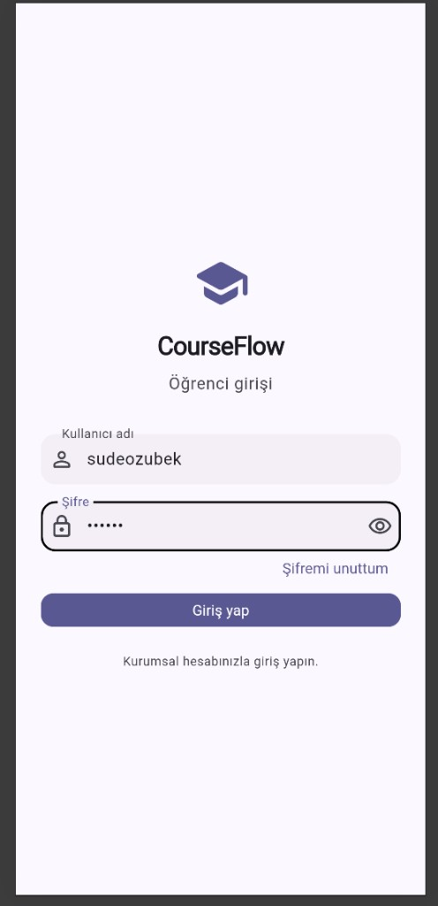</a><br/><sub>01 — Giriş</sub></td>
  <td align="center" width="25%"><a href="docs/screenshots/02-anasayfa.png">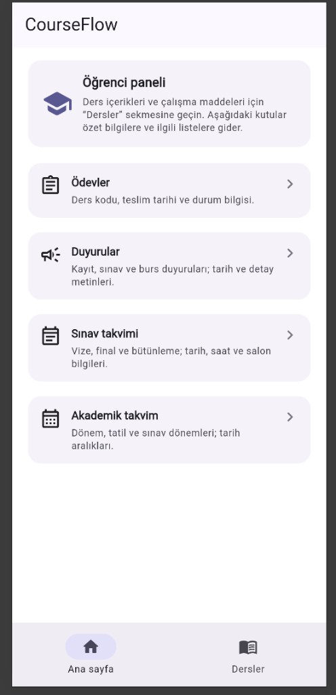</a><br/><sub>02 — Ana sayfa</sub></td>
  <td align="center" width="25%"><a href="docs/screenshots/03-dersler.png">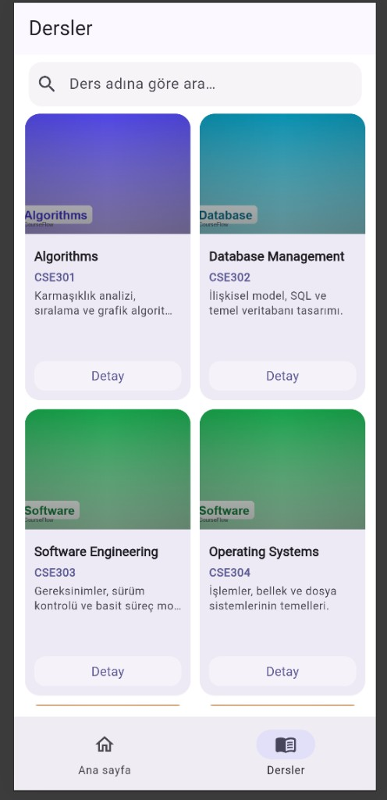</a><br/><sub>03 — Dersler</sub></td>
  <td align="center" width="25%"><a href="docs/screenshots/04-ders-detay.png">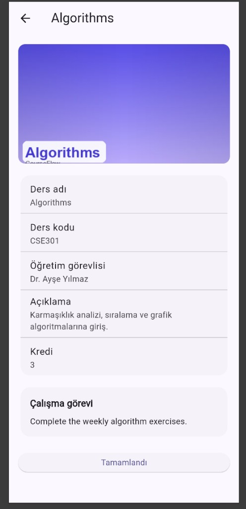</a><br/><sub>04 — Ders detayı</sub></td>
</tr>
<tr>
  <td align="center"><a href="docs/screenshots/05-ödevler.png">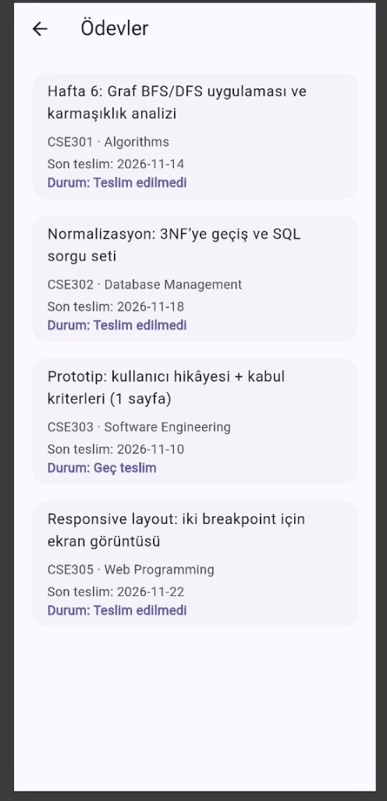</a><br/><sub>05 — Ödevler</sub></td>
  <td align="center"><a href="docs/screenshots/06-duyurular.png">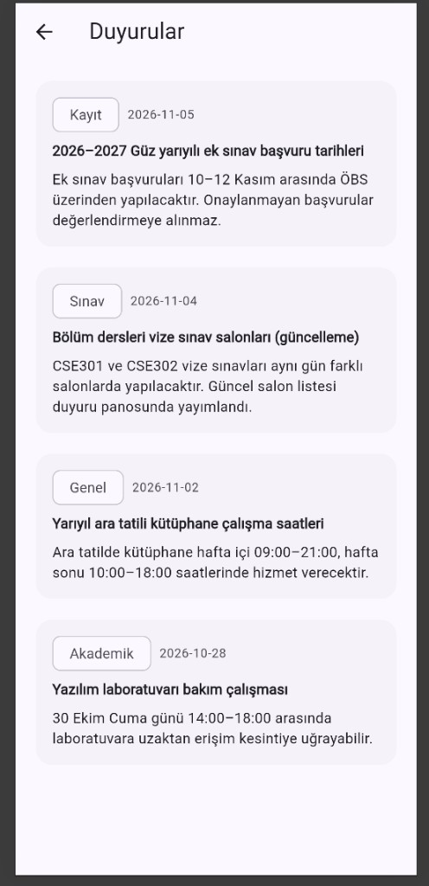</a><br/><sub>06 — Duyurular</sub></td>
  <td align="center"><a href="docs/screenshots/07-sınav-takvimi.png">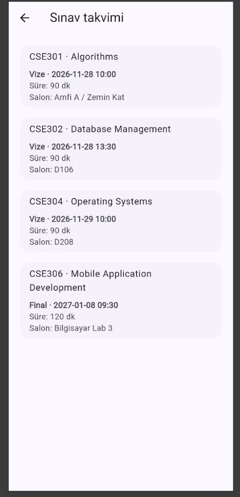</a><br/><sub>07 — Sınav takvimi</sub></td>
  <td align="center"><a href="docs/screenshots/08-akademik-takvim.png">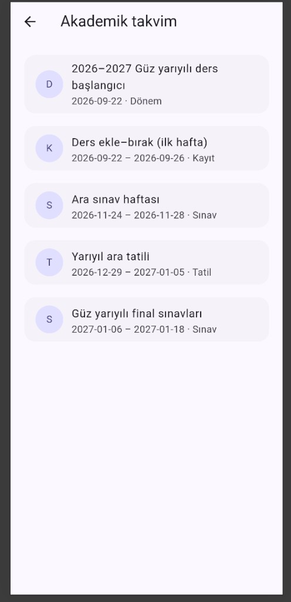</a><br/><sub>08 — Akademik takvim</sub></td>
</tr>
</table>

### Çalışma kanıtı (terminal)

Statik analiz ve `flutter run` çıktıları (Chrome ve macOS hedefleri).

<table>
<tr>
  <td align="center" width="33%"><a href="docs/screenshots/09-terminal-flutter-analyze.png">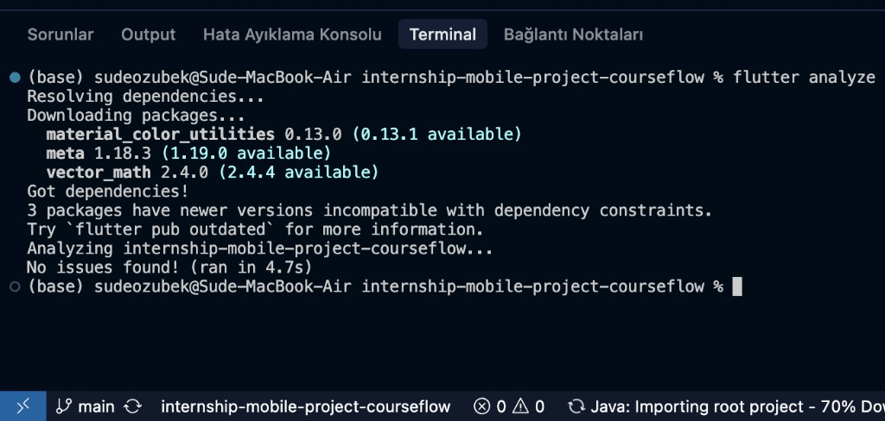</a><br/><sub>09 — <code>flutter analyze</code></sub></td>
  <td align="center" width="33%"><a href="docs/screenshots/10-terminal-flutter-run-chrome.png">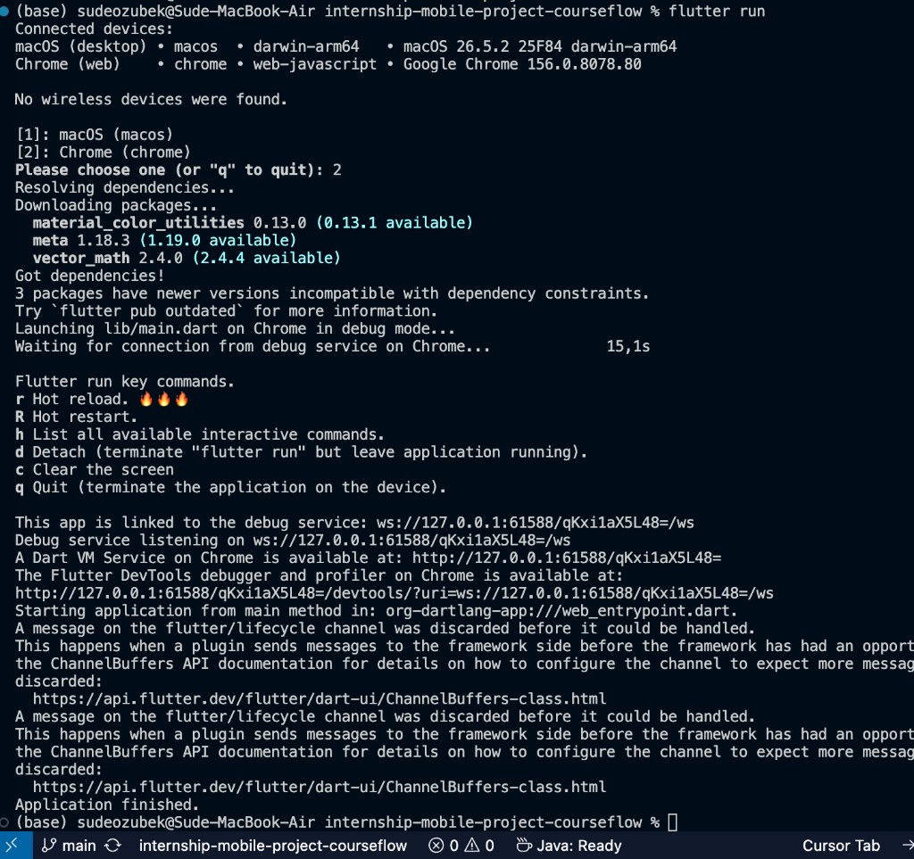</a><br/><sub>10 — <code>flutter run</code> (Chrome)</sub></td>
  <td align="center" width="33%"><a href="docs/screenshots/11-terminal-flutter-run-macos.png">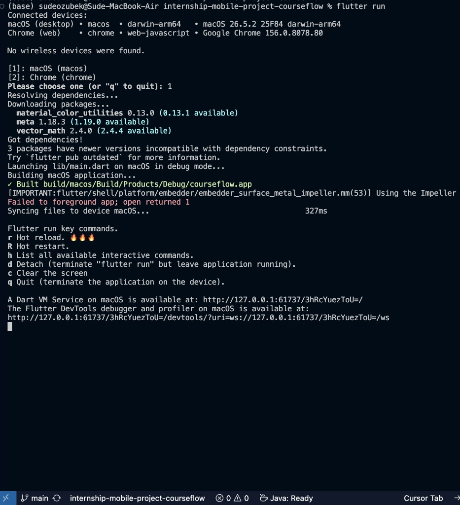</a><br/><sub>11 — <code>flutter run</code> (macOS)</sub></td>
</tr>
</table>

## How to Run

```bash
flutter pub get
flutter run
```
