# CourseFlow — ekran görüntüleri

Aşağıdaki görseller `docs/screenshots/` klasöründe numaralı dosya adlarıyla tutulur. Küçük önizlemeye tıklayınca tam boy görsel açılır (GitHub / IDE önizlemesi).

| # | Dosya | Açıklama |
|---|--------|----------|
| 1 | [01-girişekranı.png](screenshots/01-girişekranı.png) | Öğrenci girişi |
| 2 | [02-anasayfa.png](screenshots/02-anasayfa.png) | Ana sayfa (öğrenci paneli) |
| 3 | [03-dersler.png](screenshots/03-dersler.png) | Dersler listesi |
| 4 | [04-ders-detay.png](screenshots/04-ders-detay.png) | Ders detayı |
| 5 | [05-ödevler.png](screenshots/05-ödevler.png) | Ödevler |
| 6 | [06-duyurular.png](screenshots/06-duyurular.png) | Duyurular |
| 7 | [07-sınav-takvimi.png](screenshots/07-sınav-takvimi.png) | Sınav takvimi |
| 8 | [08-akademik-takvim.png](screenshots/08-akademik-takvim.png) | Akademik takvim |
| 9 | [09-terminal-flutter-analyze.png](screenshots/09-terminal-flutter-analyze.png) | Terminal: `flutter analyze` (sorun yok) |
| 10 | [10-terminal-flutter-run-chrome.png](screenshots/10-terminal-flutter-run-chrome.png) | Terminal: `flutter run` — Chrome |
| 11 | [11-terminal-flutter-run-macos.png](screenshots/11-terminal-flutter-run-macos.png) | Terminal: `flutter run` — macOS |
| 12 | [12-ödev-detay-http-post.png](screenshots/12-ödev-detay-http-post.png) | Ödev detayı: **HTTP POST** teslim arayüzü |

## Önizleme (küçük)

<table>
<tr>
  <td align="center" width="25%"><a href="screenshots/01-girişekranı.png">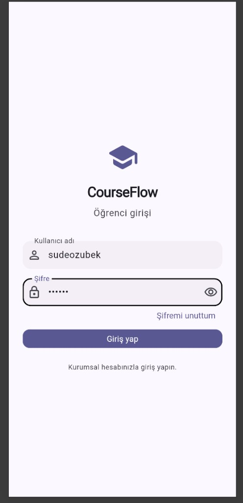</a> 01 — Giriş</td>
  <td align="center" width="25%"><a href="screenshots/02-anasayfa.png">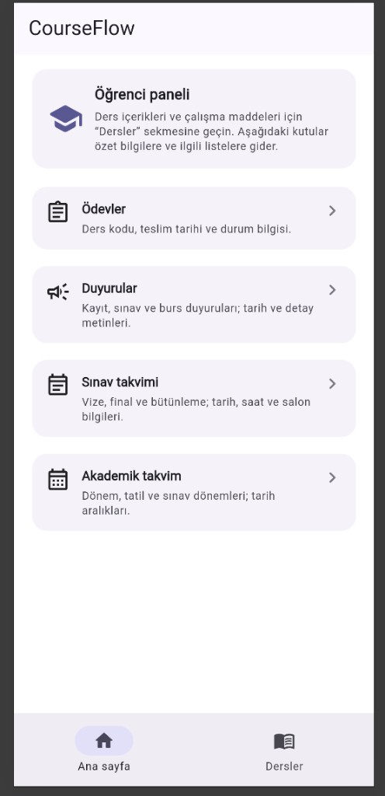</a> 02 — Ana sayfa</td>
  <td align="center" width="25%"><a href="screenshots/03-dersler.png">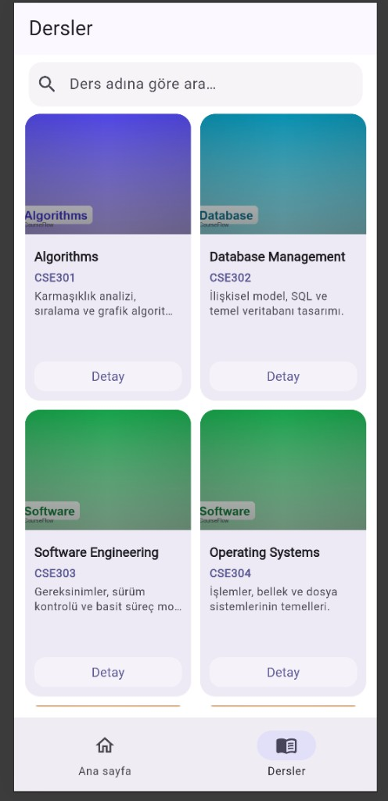</a> 03 — Dersler</td>
  <td align="center" width="25%"><a href="screenshots/04-ders-detay.png">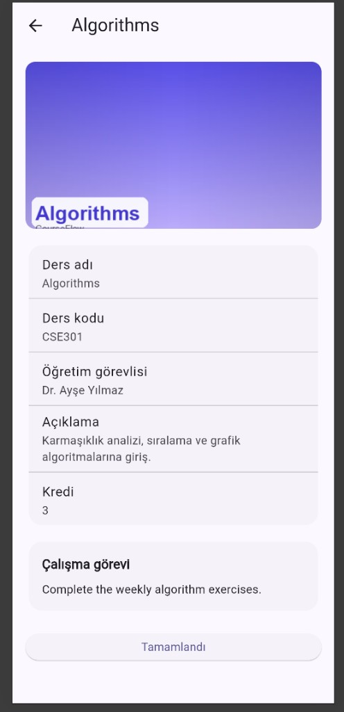</a> 04 — Ders detay</td>
</tr>
<tr>
  <td align="center"><a href="screenshots/05-ödevler.png">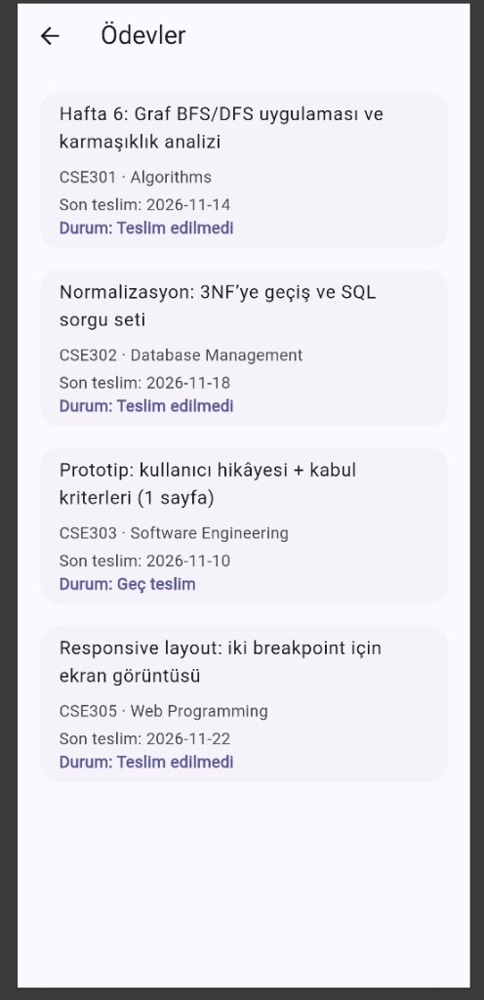</a> 05 — Ödevler</td>
  <td align="center"><a href="screenshots/06-duyurular.png">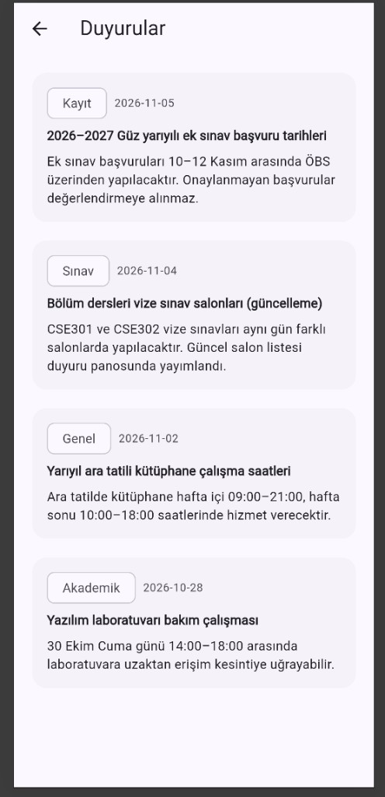</a> 06 — Duyurular</td>
  <td align="center"><a href="screenshots/07-sınav-takvimi.png">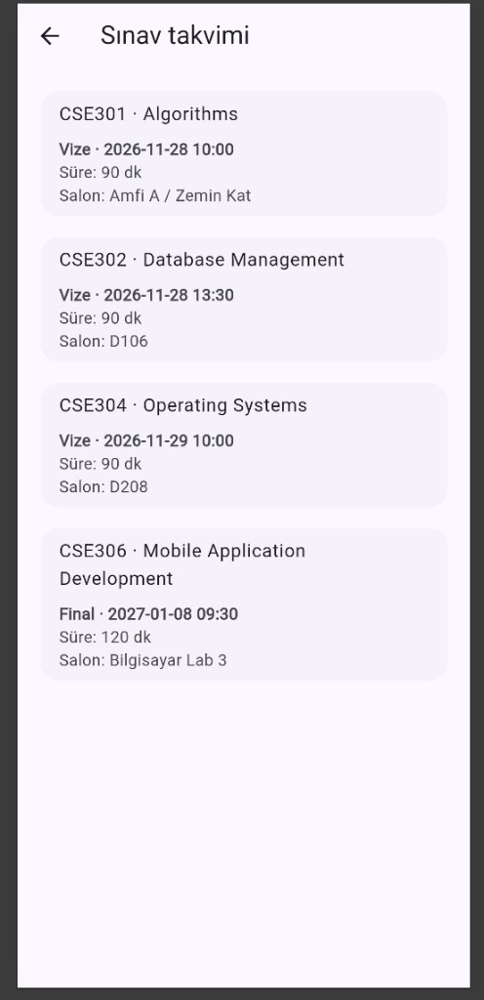</a> 07 — Sınav takvimi</td>
  <td align="center"><a href="screenshots/08-akademik-takvim.png">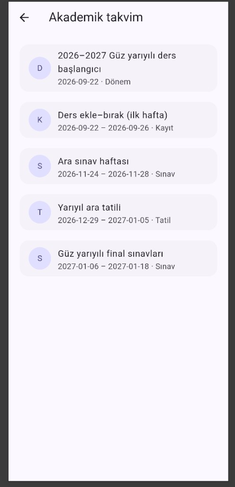</a> 08 — Akademik takvim</td>
</tr>
</table>

## HTTP API kanıtı (uygulama)

GET (wantapi katalog + banner) ve POST (ödev teslimi) uygulama içinde kullanılır; örnek: ödev detayındaki **Ödevi yükle (HTTP POST)**.

<table>
<tr>
  <td align="center"><a href="screenshots/12-ödev-detay-http-post.png">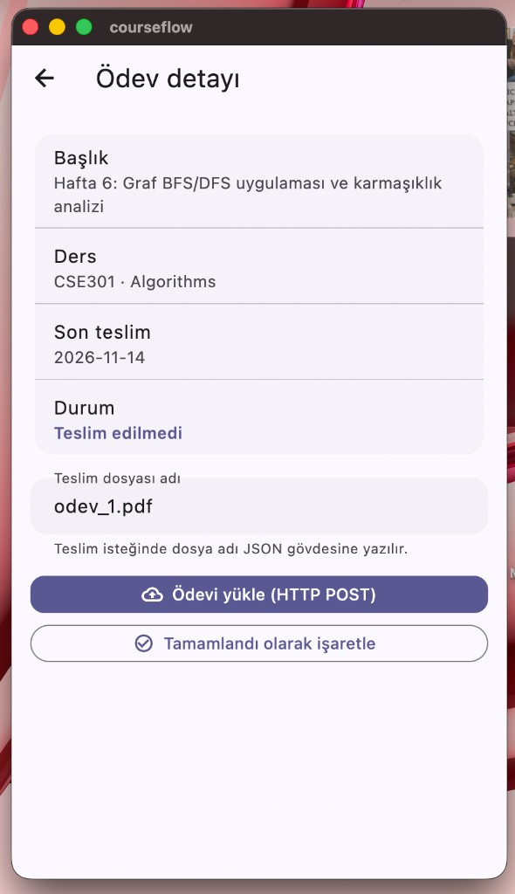</a> 12 — Ödev detayı (HTTP POST)</td>
</tr>
</table>

## Çalışma kanıtı (terminal)

<table>
<tr>
  <td align="center" width="33%"><a href="screenshots/09-terminal-flutter-analyze.png">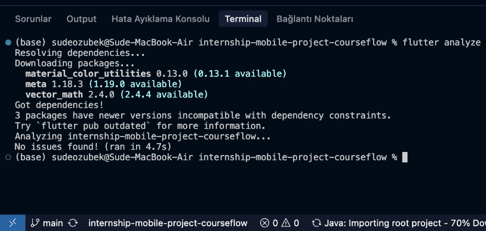</a> 09 — flutter analyze</td>
  <td align="center" width="33%"><a href="screenshots/10-terminal-flutter-run-chrome.png">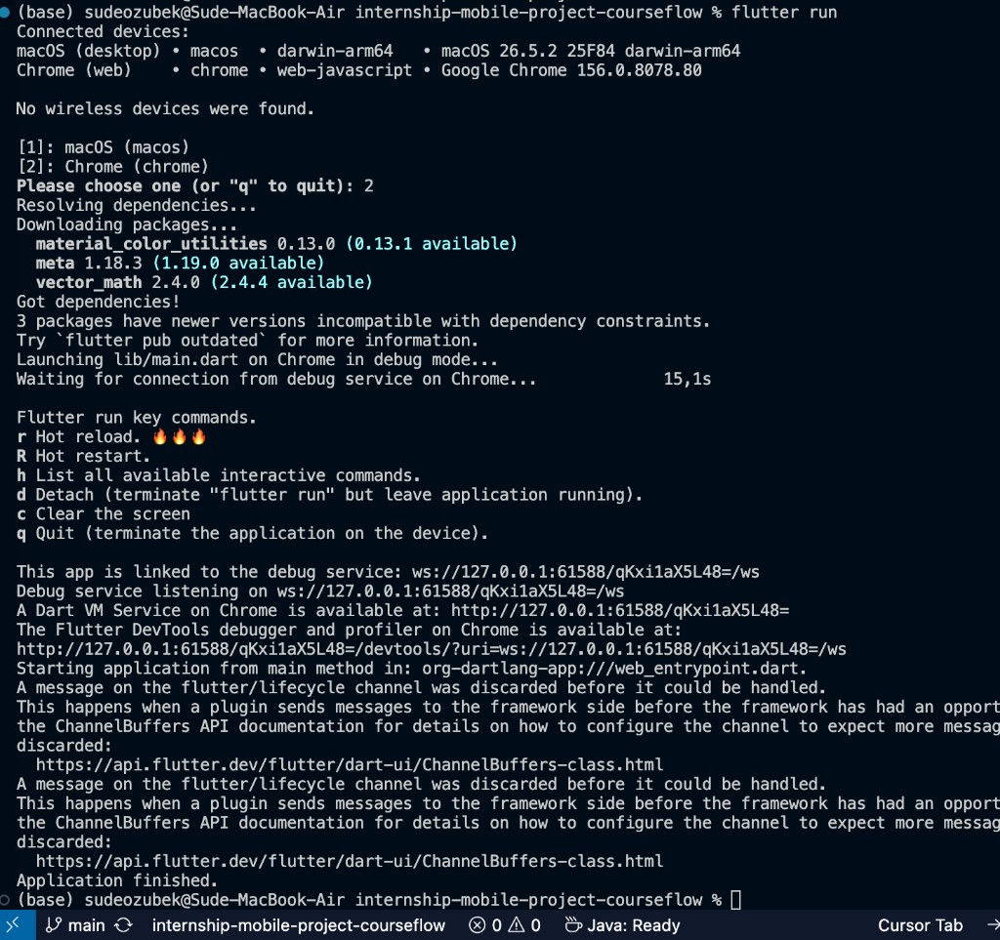</a> 10 — flutter run (Chrome)</td>
  <td align="center" width="33%"><a href="screenshots/11-terminal-flutter-run-macos.png">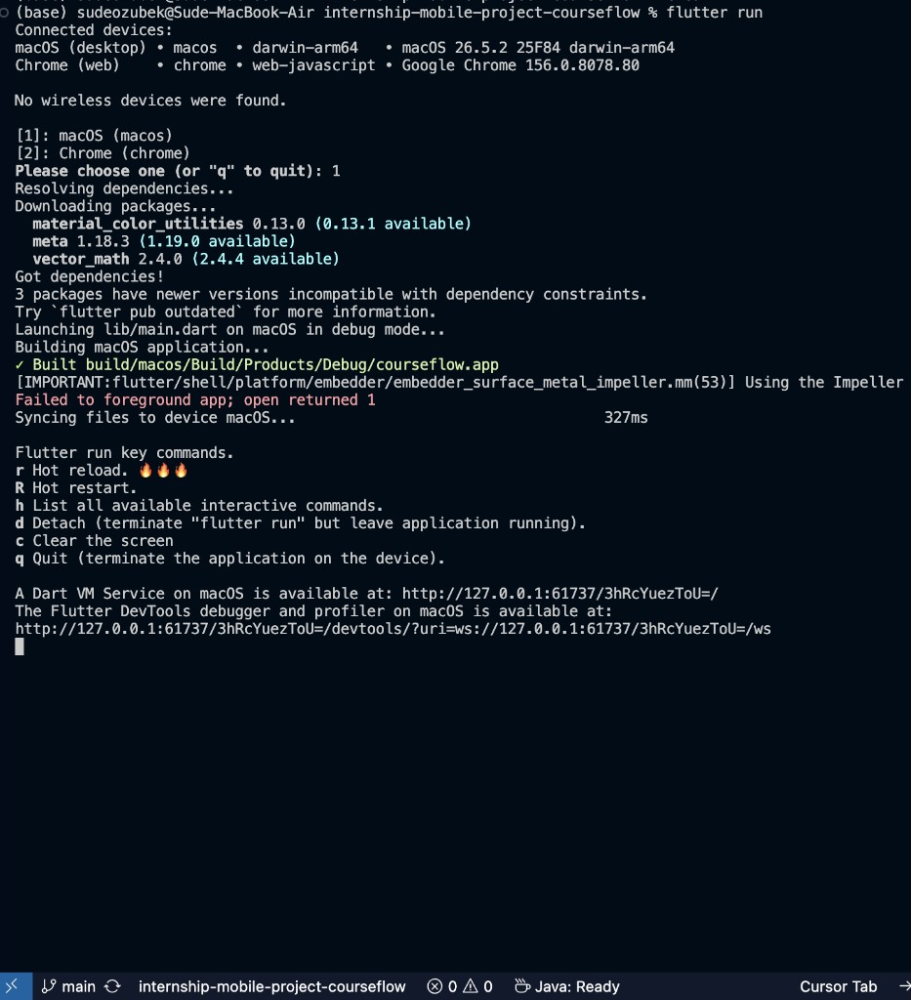</a> 11 — flutter run (macOS)</td>
</tr>
</table>
